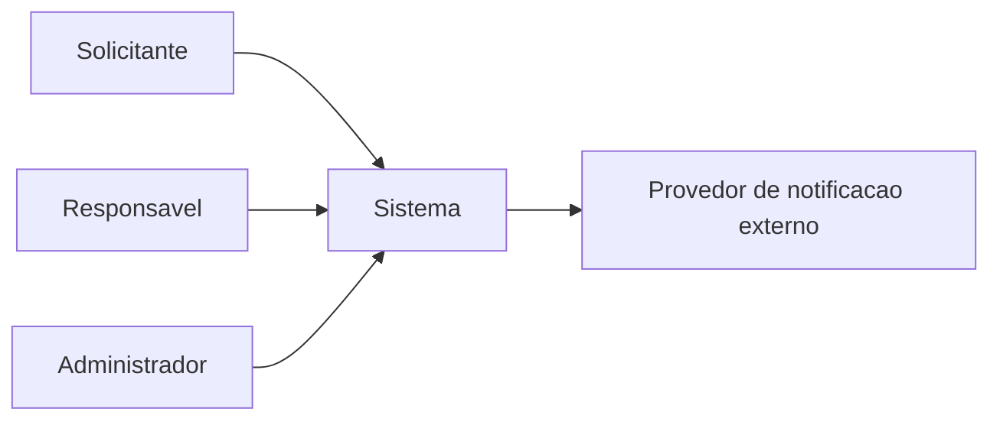
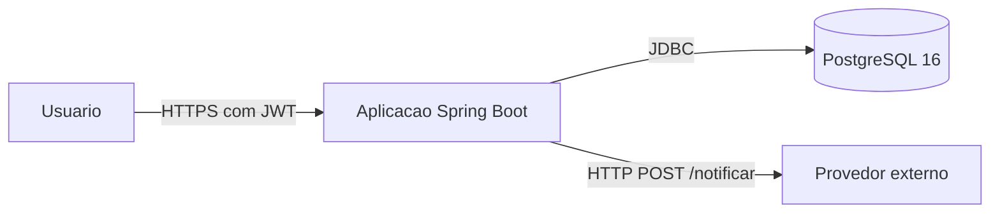
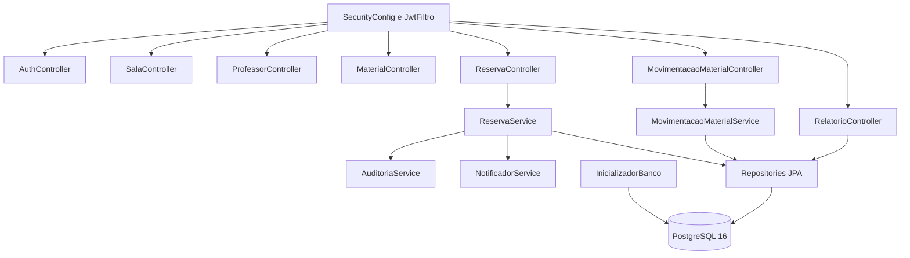
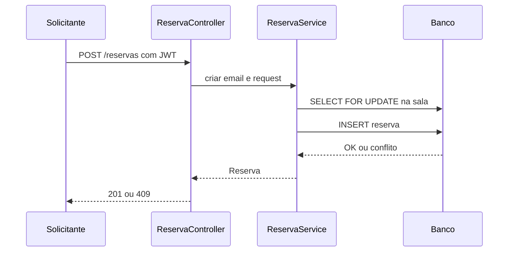
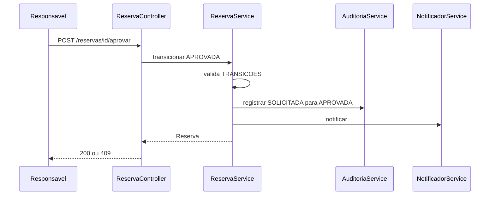
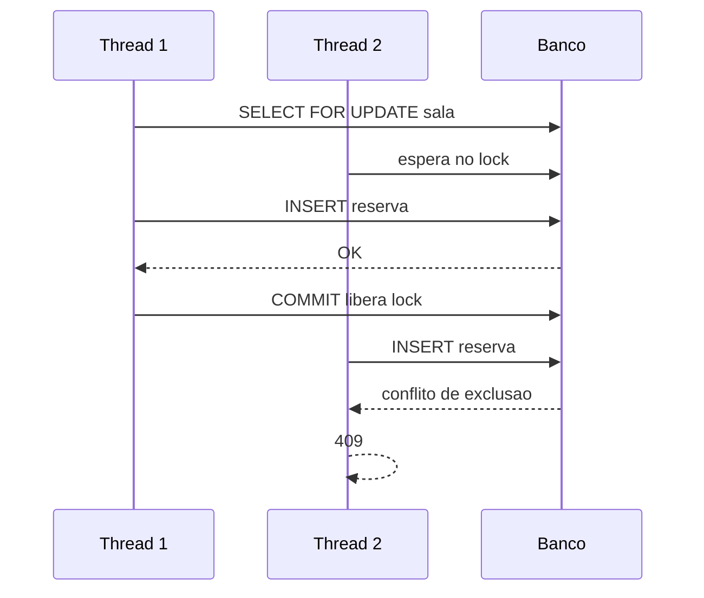

# Arquitetura do Sistema de Organizacao de Recursos

Data: 2026-10-29.

## Contexto (C4 nivel 1)

## Containers (C4 nivel 2)

## Componentes (C4 nivel 3)

## Sequencia critica 1: criacao de reserva

## Sequencia critica 2: aprovacao com auditoria e notificacao

## Sequencia critica 3: dupla reserva simultanea

## Requisito, decisao, componente, evidencia

| Requisito | Decisao | Componente | Evidencia |
|---|---|---|---|
| RF-01 autenticacao | JWT stateless | SecurityConfig e JwtFiltro | AutorizacaoPorPerfilTest |
| RF-05 sobreposicao | constraint de exclusao | InicializadorBanco | SobreposicaoTest |
| RF-06 dupla reserva | lock pessimista mais constraint | SalaRepository e ReservaService | ConcorrenciaTest |
| RF-07 aprovacao | maquina de estados | ReservaService TRANSICOES | MaquinaEstadosTest |
| RF-09 retirada e devolucao | saldo por movimentacoes | MovimentacaoMaterialService | MovimentacaoMaterialTest |
| RF-10 auditoria | MANDATORY na mesma transacao | AuditoriaService | AuditoriaTest |
| RF-11 notificacao | RestClient com timeout e tolerancia a falha | NotificadorService | NotificacaoTest |

## Riscos residuais

- Notificacao falha silenciosa: o fluxo principal nao e afetado, mas o usuario nao recebe aviso.
- Uma unica rodada de carga.
- Interface HTML parcial.
